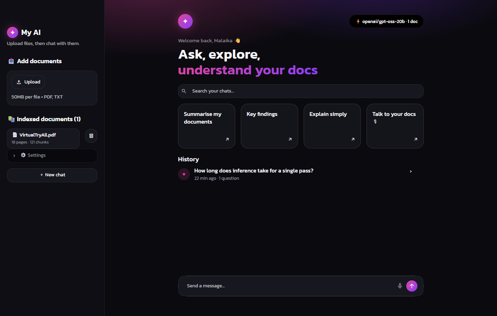
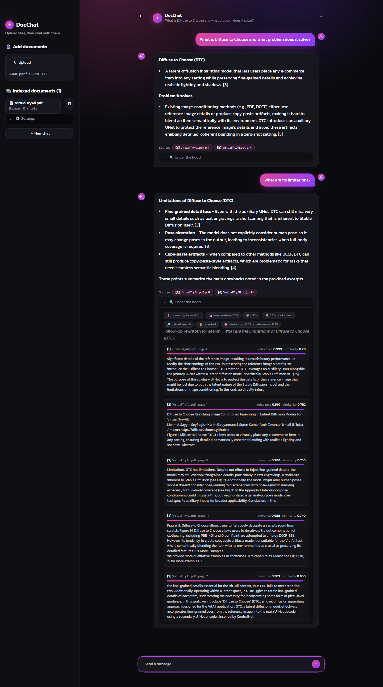
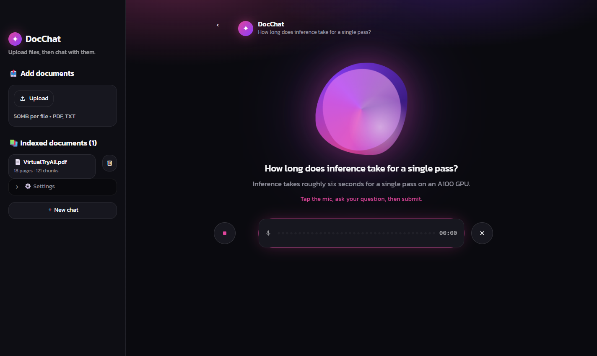

# My AI: chat with your documents

Upload PDF or TXT files, and ask questions about them. Answers come **only from your documents**, with numbered sources like `[1]` and `[2]` that link back to the file and page. If the answer isn't in your files, My AI says so instead of guessing.

Everything is free. Embeddings run locally on your computer, the vector database is a folder on disk, and the LLM runs on [Groq](https://console.groq.com)'s free tier.



## Features

- **Upload and index** PDF/TXT files from the sidebar, with a progress bar. Files are cleaned, split into chunks and stored with their file name, page and chunk number.
- **No duplicates:** a file you've already indexed is skipped, even if it's renamed, and repeated text is stored only once.
- **Grounded answers** with `[1]`, `[2]` citations and source chips (file and page) under each answer.
- **Honest "not found":** if nothing in your documents is similar enough to the question, My AI replies *"I couldn't find this in your documents"* without asking the LLM to write an answer.
- **Follow-up questions** work ("What are its limitations?"), because recent turns are used to understand the question.
- **Streaming answers**, plus an **"Under the hood"** panel showing the retrieved chunks with similarity scores and pages, the model, temperature and response time.
- **Adjustable settings** in the sidebar: top-k, hybrid search and reranker switches, thresholds, temperature, chunk size and overlap.
- **Answer actions:** copy (answer + sources), 👍/👎 (saved with the chat and logged to `data/feedback.jsonl`), and Regenerate on the latest answer.
- **Voice input:** click the mic in the chat box, speak, then press the submit button that appears (or cancel). Speech is transcribed with Groq's free Whisper model (`whisper-large-v3-turbo`). Silent recordings are rejected before they reach Groq.
- **Voice mode:** a full-screen glowing orb. Tap the mic, ask, and the answer is spoken back in short sentences. Open it from the **Talk to your docs** card or the waveform button in a chat.
- **Read aloud:** the 🔊 button under any answer reads it with your browser's built-in voice (free, offline, no API).
- **Personal welcome:** when the app opens, a short *"Welcome back, (your name)"* animation plays (set `USER_NAME` in `.env`; leave it empty for just "Welcome back").
- **Home screen and saved history:** starter cards, and a searchable History of past chats (saved in `data/chats/`). Reopen a chat with ›, delete one with 🗑 (or from the chat's ⋮ menu), or use **Clear all** to delete every chat after a confirmation, optionally including your 👍/👎 ratings.





## How it works

```
 Indexing                                        Asking
 ────────                                        ──────
 PDF / TXT                                       Question (+ recent chat)
    │ PyPDF / TextLoader                            │ follow-up? → rewritten to stand alone (Groq)
    ▼                                               ▼
 clean text, page by page                        embed with bge query prefix
    │ RecursiveCharacterTextSplitter                │
    ▼                                               ▼
 chunks + metadata + hashes ──► skip duplicates   ChromaDB: top-k by cosine similarity
    │ bge-small-en-v1.5 (local)                     │
    ▼                                               ├─ best score < threshold → "I couldn't find this…"
 ChromaDB (data/chroma_db) ◄────────────────────────┘
                                                    └─ otherwise → numbered chunks → Groq → streamed answer [1][2]
```

| Part | Tool |
|---|---|
| LLM | Groq via `langchain-groq` (default `openai/gpt-oss-20b`) |
| Embeddings | `BAAI/bge-small-en-v1.5` with `sentence-transformers`, local, normalized |
| Vector database | ChromaDB, persistent, cosine similarity |
| Loading and splitting | PyPDF, LangChain loaders, `RecursiveCharacterTextSplitter` |
| UI | Streamlit, with a custom dark theme |

## Setup (Windows)

You need **Python 3.11 or newer** and a free **Groq API key**.

```powershell
# 1. Get the code
git clone https://github.com/<your-username>/RAG_chatabot_with_Langchain.git
cd RAG_chatabot_with_Langchain

# 2. Create and activate a virtual environment
python -m venv .venv
.\.venv\Scripts\Activate.ps1
#    If you see "running scripts is disabled", run this once and try again:
#    Set-ExecutionPolicy -Scope CurrentUser RemoteSigned

# 3. Install packages (5–10 minutes, about 400 MB)
python -m pip install --upgrade pip
pip install -r requirements.txt

# 4. Add your Groq key (free at https://console.groq.com/keys)
copy .env.example .env
notepad .env          # paste the key after GROQ_API_KEY=

# 5. Check everything works (downloads the ~130 MB embedding model the first time)
python scripts/check_setup.py

# 6. Run the app (opens http://localhost:8501)
streamlit run app.py
```

On macOS or Linux, activate with `source .venv/bin/activate` and copy with `cp .env.example .env`.

## Using it

1. In the sidebar, upload one or more PDF/TXT files and click **Index**.
2. Ask a question in the chat box, or click a starter card. Each chat is saved to **History** on the home screen.
3. Check the source chips under the answer, and open **Under the hood** to see exactly which chunks were used and how similar they were. Use the icons under an answer to copy it, rate it 👍/👎, or regenerate it.
4. Use the trash icon to remove a document, **New chat** (or ‹) to go back home, and the ⋮ menu to delete a chat.

A sample paper is included in `data/sample_docs/` to try it out.

You can also chat from the terminal:

```powershell
python scripts/try_ingestion.py path\to\file.pdf   # index a file and show search scores
python scripts/ask.py                              # chat in the terminal
```

## Configuration

All settings live in `.env` (see `.env.example`). The sidebar sliders override them for the current session.

| Setting | Default | What it does |
|---|---|---|
| `USER_NAME` | (empty) | Your first name for the "Welcome back" greeting |
| `GROQ_API_KEY` | — | Your Groq key (required) |
| `GROQ_MODEL` | `openai/gpt-oss-20b` | Any chat model from [Groq's model list](https://console.groq.com/docs/models) |
| `TEMPERATURE` | `0.2` | Lower values give more focused answers |
| `WHISPER_MODEL` | `whisper-large-v3-turbo` | Groq speech-to-text model for the mic button |
| `EMBEDDING_MODEL` | `BAAI/bge-small-en-v1.5` | Local embedding model |
| `CHUNK_SIZE` / `CHUNK_OVERLAP` | `600` / `100` | Chunk length and overlap, in characters |
| `TOP_K` | `5` | How many chunks to retrieve |
| `SCORE_THRESHOLD` | `0.55` | Minimum cosine similarity. Below it, the app replies "not found" |
| `HYBRID_SEARCH` | `true` | Combine meaning-based search with keyword (BM25) search. Better for names, numbers and acronyms |
| `USE_RERANKER` | `true` | Rescore the top candidates with a local cross-encoder. Ranks answers higher and rejects off-topic questions reliably. Adds ~1.3 s per question on CPU |
| `RERANKER_MODEL` | `cross-encoder/ms-marco-MiniLM-L-6-v2` | Reranker model (~90 MB, downloaded on first use) |
| `RERANK_CANDIDATES` | `20` | How many search results the reranker looks at |
| `RERANK_THRESHOLD` | `0.1` | Reranker relevance (0–1). A chunk is used if similarity ≥ `SCORE_THRESHOLD` **or** relevance ≥ this |
| `HISTORY_TURNS` | `3` | Previous question/answer pairs used for follow-ups |
| `LOG_LEVEL` | `INFO` | Logging detail in the terminal |
| `DATA_DIR` | `data` | Where uploads, the index and chats are stored. Point it elsewhere to run a separate demo copy |

**Tuning the threshold:** run `python scripts/try_ingestion.py`. It prints the scores for a relevant and an unrelated question. With bge-small, relevant matches usually score around 0.6–0.75, and unrelated ones around 0.45.

## Measuring accuracy

`scripts/evaluate.py` scores retrieval on a test set: questions about a document, each with text that proves the right chunk was found, plus off-topic questions that should be rejected. It compares embedding-only search, hybrid search and the reranker, and suggests the best threshold for each. It doesn't call the LLM, so it's free.

```powershell
python scripts/evaluate.py                         # every test set in data/eval/
python scripts/evaluate.py --chunk-size 800        # try other chunk sizes
```

To test your own document, copy `data/eval/sample_questions.json`, point `"document"` at your file, and write your own questions.

On the included sample paper (18 questions, 6 off-topic), with the default thresholds:

| Setup | Answer found in top 5 | Accuracy* | Time per question |
|---|---|---|---|
| Embeddings only | 89% | 92% | 0.05 s |
| Hybrid | 94% | 96% | 0.06 s |
| **Hybrid + reranker (default)** | 94% | 96% | 1.3 s |

The reranker ranks the right chunk higher (MRR 0.82 vs 0.77), and on documents like lists or tables it catches answers that similarity alone scores too low.

\*Real questions whose answer reached the LLM, plus off-topic questions correctly rejected.

## Project structure

```
app.py                     Streamlit app
config/settings.py         settings from .env, with defaults and validation
src/
  ingestion/               loader.py (load + clean), chunker.py (chunks + hashes), indexer.py
  embeddings/embedder.py   local bge embeddings
  vectorstore/chroma_store.py   ChromaDB wrapper (search, list, delete)
  retrieval/               retriever.py (search, merging, threshold), keyword_search.py (BM25), reranker.py
  generation/              prompts.py (all prompt text), generator.py (Groq, streaming, errors)
  rag_pipeline.py          ties everything together: index_file(), ask()
  chat_history.py          saving and loading chats (data/chats/)
  voice/transcriber.py     speech to text (Groq Whisper) with a silence check
  voice/speech.py          cleans answers for reading aloud (no [1], no Markdown)
  ui/                      styles.py (CSS), components.py (home, history, chips, Under the hood)
.streamlit/config.toml     theme: colours, Kanit font
scripts/                   check_setup.py, try_ingestion.py, ask.py, evaluate.py
data/eval/                 test sets for scripts/evaluate.py
tests/                     pytest tests (no API key needed)
data/uploads, data/chroma_db   your files and index (not committed)
```

## Tests

```powershell
pytest
```

The 54 tests cover loading, cleaning, chunking, duplicate skipping, search, keyword and hybrid search, the reranker, the score threshold (including an off-topic question that must not reach the LLM), citations, saved chat history, feedback and regenerate, voice transcription (with a fake Groq client), speech cleanup, voice mode, and the Streamlit app itself (via Streamlit's `AppTest`). They use temporary databases and a fake LLM, so they're free, need no API key, and leave your real index alone.

## Troubleshooting

| Problem | Fix |
|---|---|
| `No module named 'langchain_groq'`, or a Keras / TensorFlow error | The virtual environment isn't active, so a different Python is running. Activate `.venv` first. |
| "No Groq API key found" | Copy `.env.example` to `.env`, add your key, and restart the app. |
| "Groq's free-tier rate limit was reached" | Wait about a minute and try again. |
| "Groq doesn't recognise the model" | The model was retired. Pick one from [Groq's model list](https://console.groq.com/docs/models) and set `GROQ_MODEL`. |
| "No text found in …pdf" | The PDF is probably scanned images. My AI can only read PDFs with selectable text. |
| Mic button does nothing, or the browser blocks it | Allow microphone access when the browser asks. Browsers only allow the mic on `http://localhost` or `https://`, not on a network address like `http://192.168…`. |
| Answers aren't read aloud | Reading aloud uses your browser's voices, which come from your operating system. Check the volume and that an English voice is installed (Windows: Settings → Time & language → Speech). Voice mode can only speak after you've clicked something on the page, such as the mic. |
| "I couldn't hear anything" | The recording was nearly silent. Check the right microphone is selected in Windows sound settings. |
| Want to improve answers you rated 👎 | Each rating is a line in `data/feedback.jsonl` (question, answer, sources). Turn 👎 ones into test questions for `scripts/evaluate.py`. |
| Answers miss something you know is in the file | Try a smaller chunk size (re-index the file afterwards), a higher top-k, or a slightly lower threshold. |

## Credits

This is a fork of [AlaGrine/RAG_chatabot_with_Langchain](https://github.com/AlaGrine/RAG_chatabot_with_Langchain), rebuilt from scratch as a free, modular app. The original code is still in that repository and in this fork's early git history. The sample paper is *Diffuse to Choose* (Seyfioglu et al., 2024).
